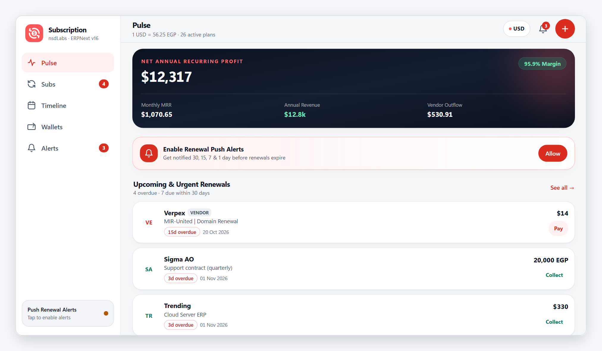
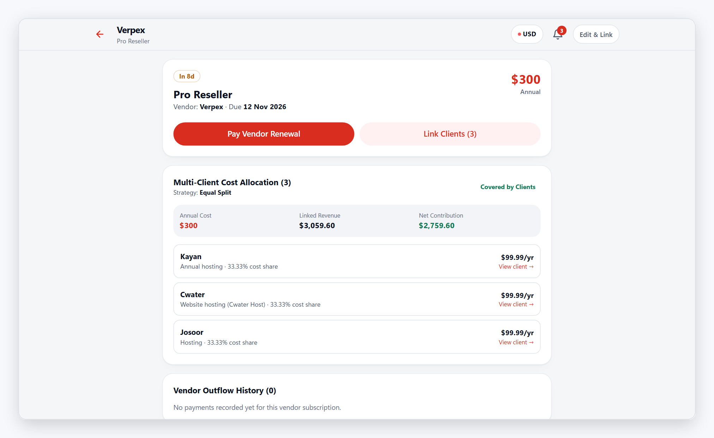
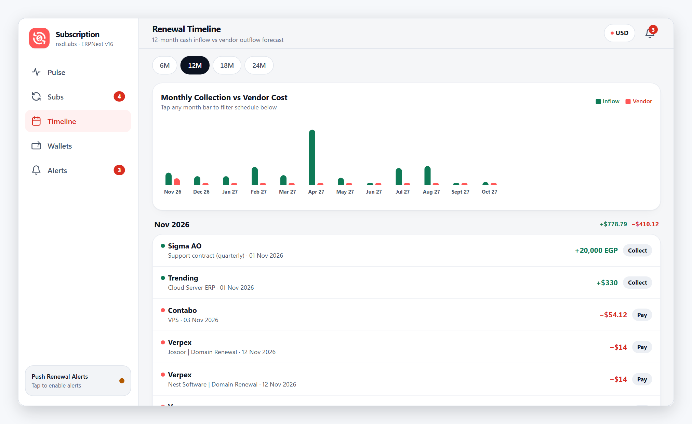
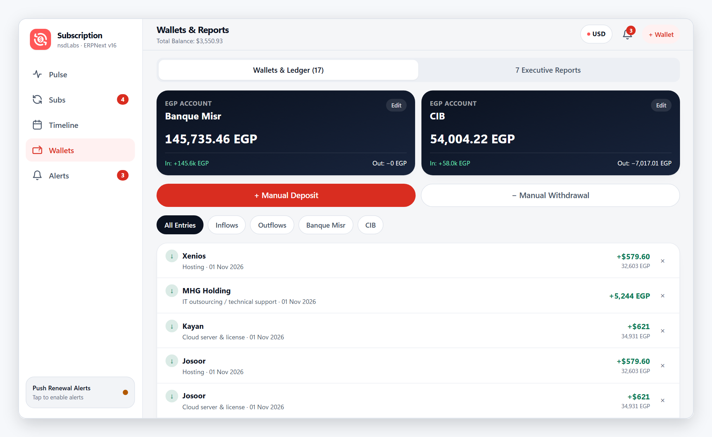
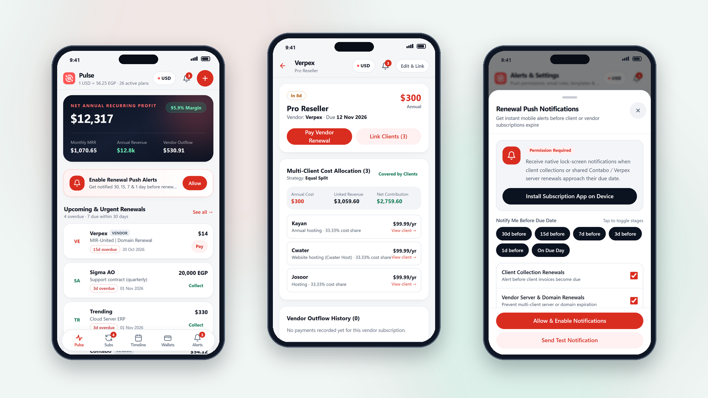
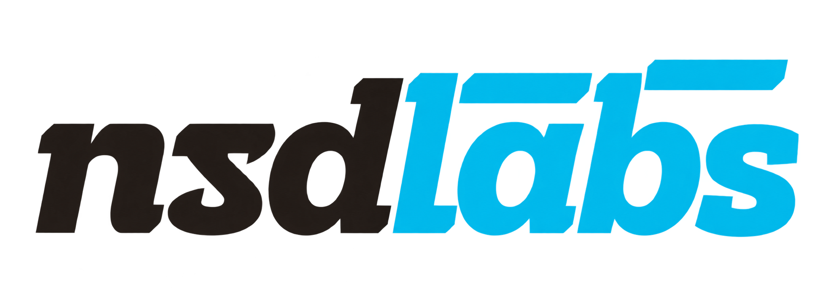

<div align="center">
	<a href="https://nsd-eg.com">
		
	</a>
	<h1>Subscription</h1>
	<p align="center">
		<strong>Recurring Revenue, Multi-Client Vendor Cost Allocation, Treasury Wallets &amp; Mobile Renewal PWA for ERPNext v16.52</strong>
	</p>

[](https://erpnext.com)
[](https://www.python.org)
[](docs/images/mobile-pwa-showcase.png)
[](#push-notifications--automated-renewal-alerts)
[](license.txt)

</div>

<div align="center">
	
</div>

<p align="center">
	<a href="#key-features">Features</a> ·
	<a href="#mobile-pwa-app">Mobile PWA</a> ·
	<a href="#installation">Installation</a> ·
	<a href="#push-notifications--automated-renewal-alerts">Push Notifications</a> ·
	<a href="mailto:info@nsd-eg.com">Contact Support</a>
</p>

## Subscription for ERPNext

**Subscription** is an open-source, production-grade recurring revenue, vendor infrastructure cost-allocation, wallet treasury, and automated renewal management application built natively on **Frappe & ERPNext v16.52** by **nsdLabs** (*Nest Software Development*).

## Introduction

Managing agency, SaaS, cloud hosting, and support subscriptions requires more than tracking client invoices in isolation. Frequently, **one vendor subscription** (such as a Contabo VPS, dedicated cloud cluster, or Verpex Pro Reseller account) powers **multiple client subscriptions** across different currencies (`USD` and `EGP`) and billing cycles.

**Subscription** connects client inflows, shared multi-client vendor outflows, multi-currency bank/cash wallets, branded SMTP renewal reminders, 7 executive reports, and a **100% native-feeling Mobile PWA (`/subscriptions`)** with **Web Push Notifications** into one unified ERPNext v16.52 app.

## Key Features

- **Client Subscriptions & One-Tap Collections**: Manage `Monthly`, `Quarterly`, `Annual`, and `Biennial` recurring contracts in `USD` or `EGP` with real-time urgency states (`Overdue`, `Due Today`, `Due within 7d`, `Due within 30d`, `Upcoming`), optional ERPNext `Customer` auto-linking, and one-tap **Record Collection** that posts to a Wallet and advances `next_due_date` automatically.
- **Multi-Client Vendor Cost Linking ("My Payments")**: Link **one Vendor Subscription to multiple Client Subscriptions** via `Vendor Subscription Link` using **Equal Split** (`Annual Cost ÷ N`), **Revenue Proportional**, or **Custom Percentage (%)** allocation. Automatically calculates allocated vendor cost, net annual profit, and net margin % per client, while flagging unlinked vendor subscriptions as company overhead.
- **Multi-Currency Bank & Cash Wallets**: Track `Banque Misr`, `CIB`, or custom `USD`/`EGP` treasury accounts with opening balances, live `USD ↔ EGP` FX conversion, manual deposits/withdrawals, and archive-safe deletion protection when ledger transactions exist.
- **Branded HTML Email Studio & Customer Reminder Rules**: Choose between **Nest Executive**, **Modern Coral**, and **Minimal Clean** HTML templates with editable tokenized copy (`{client}`, `{service}`, `{amount}`, `{due}`, `{when}`, `{days}`, `{cycle}`), inline logo & signature support, live HTML preview, `[TEST]` dispatch, per-client `30 / 15 / 7 / 1` day stage chips, and stage-deduplicated `Subscription Email Log`.
- **7 Built-in ERPNext Script Reports & v16 Workspace**: Ships with a complete ERPNext v16 Desk Workspace, Sidebar icons, Dock tile, Number Cards, Dashboard Chart, and 7 Script Reports:
  1. `Monthly Collection Forecast`
  2. `Annualized Revenue by Client`
  3. `Revenue by Billing Cycle`
  4. `Detailed Payment Schedule`
  5. `Cost and Profit by Service`
  6. `Profit by Client`
  7. `Subscription Cash Flow`
- **Native-Grade Mobile PWA (`/subscriptions`)**: Designed to Apple Human Interface Guidelines with functional Liquid Glass navigation & floating pill tab bar, adaptive tablet/desktop sidebar rail (`≥ 840px`), View Transitions directional push/pop navigation, hardware-back sheet stack, pull-to-refresh, haptics, WebAuthn Face ID / Touch ID App Lock, IndexedDB offline cache, and **RFC 8291 VAPID Web Push Notifications** with interactive permission onboarding.

### Multi-Client Vendor Infrastructure & Cost Split

<div align="center">
	
</div>

### Chronological Renewal Timeline & Forecast

<div align="center">
	
</div>

### Multi-Currency Bank Wallets & 7 Executive Reports

<div align="center">
	
</div>

## Mobile PWA App

Open `https://<your-site>/subscriptions` on iOS or Android and add **Subscription** to your Home Screen for a full-screen standalone mobile experience with home-screen shortcuts, app icon badging, offline snapshot reading, and lock-screen renewal push notifications:

<div align="center">
	
</div>

## Under the Hood

- **[Frappe Framework v16](https://frappeframework.com) & [ERPNext v16.52](https://erpnext.com)**: Full-stack DocTypes, controllers, role permissions, daily scheduler tasks, v16 Workspace/Dock/Sidebar integration, and Script Reports on Python `>=3.14`.
- **[Vue 3](https://vuejs.org) + [Vite](https://vitejs.dev) + [Tailwind CSS](https://tailwindcss.com) + [Workbox](https://developer.chrome.com/docs/workbox)**: Decoupled mobile-first PWA served at `/subscriptions` with zero-config Service Worker delivery (`Service-Worker-Allowed: /subscriptions`).
- **RFC 8291 VAPID Web Push (`pywebpush` + `cryptography`)**: Native encrypted push notifications to iOS (16.4+ Home Screen PWA), Android Chrome/Edge, and Desktop browsers without external Firebase dependencies.

## Installation

### Bench CLI (Development & Production)

Assuming you have a running Frappe v16 / ERPNext v16.52 bench:

1. **Get the app** into your bench `apps` directory:

```sh
bench get-app https://github.com/Nest-Software-Development/subscription.git
```

2. **Install `subscription` on your site**:

```sh
bench --site your-site.localhost install-app subscription
```

3. **Run migrations & build frontend assets**:

```sh
bench --site your-site.localhost migrate
bench build --app subscription
bench --site your-site.localhost clear-cache
```

> On first install, `after_install` automatically generates your site's **VAPID public/private keypair** in `Subscription Settings` and seeds the workspace if empty. You can also sync or import workspace backups anytime from **Subscription Settings** or the PWA.

### Push Notifications & Automated Renewal Alerts

1. Ensure your Frappe scheduler is enabled so daily email reminders and device push checks run automatically:

```sh
bench --site your-site.localhost enable-scheduler
```

2. Open `https://<your-site>/subscriptions` on your mobile device:
   - **Android (Chrome / Edge)**: Tap **Install Subscription App**, then tap **Allow & Enable Notifications** in the Renewal Push sheet.
   - **iPhone / iPad (iOS 16.4+)**: Tap Safari's **Share** button → **Add to Home Screen**, open **Subscription** from your Home Screen, and tap **Allow & Enable Notifications**.
3. Customize your lead-day stages (default: `30, 15, 7, 3, 1, 0` days before renewal) and tap **Send Test Notification** from **Alerts & Settings** to verify instant delivery.

### Rebuilding the Mobile PWA Frontend

When modifying files inside `frontend/`:

```sh
cd apps/subscription/frontend
npm install
npm run build
```

This compiles the production bundle into `subscription/public/frontend/`, injects the Workbox precache manifest into `sw.js`, and updates `subscription/www/subscriptions.html`.

## Publisher & Support

- **Publisher**: **nsdLabs** under **Nest Software Development**
- **Email**: [info@nsd-eg.com](mailto:info@nsd-eg.com)
- **License**: [MIT](license.txt)

<br />

<div align="center">
	<p>Built with ❤️ by <strong>nsdLabs</strong> — <strong>Nest Software Development</strong> (<a href="mailto:info@nsd-eg.com">info@nsd-eg.com</a>)</p>
	<a href="https://nsd-eg.com">
		
	</a>
</div>

